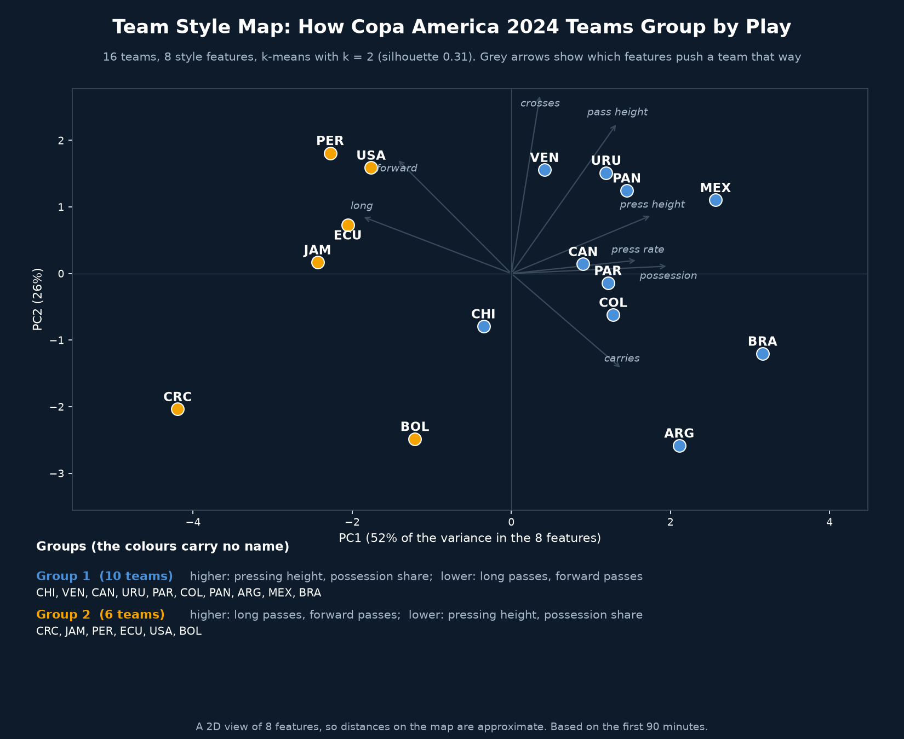
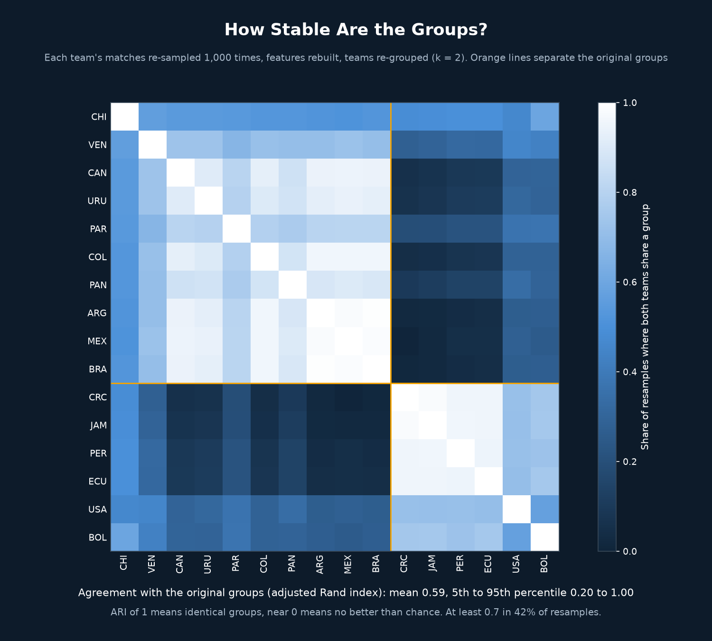

# Team Style Map

## Why
"Possession football" and "direct football" are labels people use without measuring them. This project describes each of the 16 Copa America 2024 teams with 8 style features, groups them with k-means, and then tests whether the groups survive when the matches change.

## What it does
- Builds 8 features per team from the first 90 minutes: possession share, long passes (30+ yards), forward passes (10+ yards gained), pass height, pressing height, pressing rate, crosses and carries
- Standardises the features and draws a 2D map with PCA (written in NumPy)
- Groups teams with k-means (written in NumPy, 100 restarts) and picks k from 2 to 5 by silhouette score
- Re-samples each team's matches 1,000 times, rebuilds the features, re-groups, and measures agreement with the original groups using the adjusted Rand index (ARI)
- Shows xG for and against per match next to each group, without using them to build the groups
- Replays the process: k-means rounds on the map, then re-sampled groupings with changed teams marked

## Key findings

| Group | Teams | Higher | Lower | xG for per match | xG against per match |
|---|---|---|---|---|---|
| 1 (10 teams) | Argentina, Brazil, Canada, Chile, Colombia, Mexico, Panama, Paraguay, Uruguay, Venezuela | pressing height, possession share | long passes, forward passes | 1.13 | 0.90 |
| 2 (6 teams) | Bolivia, Costa Rica, Ecuador, Jamaica, Peru, United States | long passes, forward passes | pressing height, possession share | 0.62 | 1.35 |

| Check | Result |
|---|---|
| Variance on PC1 and PC2 | 52% and 26% |
| Silhouette by k | k=2: 0.314, k=3: 0.300, k=4: 0.233, k=5: 0.202 |
| ARI vs original groups, 1,000 resamples | mean 0.59, median 0.53, 5th to 95th 0.20 to 1.00 |
| Resamples with ARI of 0.7 or more | 42% |
| Resamples with ARI of 0.5 or more | 74% |

| Team | Group | Stays with its group-mates | Matches |
|---|---|---|---|
| Jamaica, Costa Rica, Ecuador | 2 | 0.87 | 3, 3, 4 |
| Mexico, Brazil, Argentina, Colombia, Canada, Uruguay | 1 | 0.84 to 0.86 | 3 to 6 |
| Peru | 2 | 0.86 | 3 |
| Panama, Paraguay | 1 | 0.81, 0.76 | 4, 3 |
| Bolivia, United States | 2 | 0.71, 0.69 | 3, 3 |
| Venezuela | 1 | 0.70 | 4 |
| Chile | 1 | 0.54 | 3 |

- The 8 features mostly move together. PC1 carries 52% of the variance: possession share, pressing height and rate, pass height and carries go one way, long and forward passes the other. The map looks like a line from direct to possession, not separate clusters
- Two groups was the best split, but only just: the silhouette of 0.31 is on the weak side, and k=3 scored 0.30
- The groups are partly stable. Agreement with the original groups averaged 0.59 and reached 0.7 or more in 42% of resamples. Chile moved most (54% of the time with its group-mates), while Argentina, over 6 matches, stayed 86%
- The groups line up with results even though results were not used to build them: Group 1 averaged 1.13 xG for and 0.90 against, Group 2 averaged 0.62 and 1.35. Part of what looks like style is likely team strength, and this was not tested

## Limitations
- 16 teams with 3 to 6 matches each, so one match can move a team across the map
- The groups depend on the 8 features I chose. Other features can give other groups
- Features describe how a team played against its own opponents and scorelines, so they mix style with team strength, opponent and game state
- Stability here re-samples matches, not features or k, so it shows how fragile the groups are, not whether they are right
- Groups are not named: a name is a decision, not a result
- The map is a 2D view of 8 features, so distances on it are approximate
- First 90 minutes only, extra time and shootouts excluded

## Visual

*16 teams on the first two principal components, coloured by group. Grey arrows show which features push a team in each direction.*

*Share of 1,000 resamples in which two teams share a group. Orange lines separate the original groups.*

`team_style_replay.mp4` replays the clustering and the re-sampling and ends with both charts.

## Tools
Python, pandas, NumPy, matplotlib, imageio-ffmpeg. PCA, k-means, silhouette score and adjusted Rand index are written in NumPy.

## Data source
StatsBomb open data, Copa America 2024 (32 matches). First 90 minutes only.
